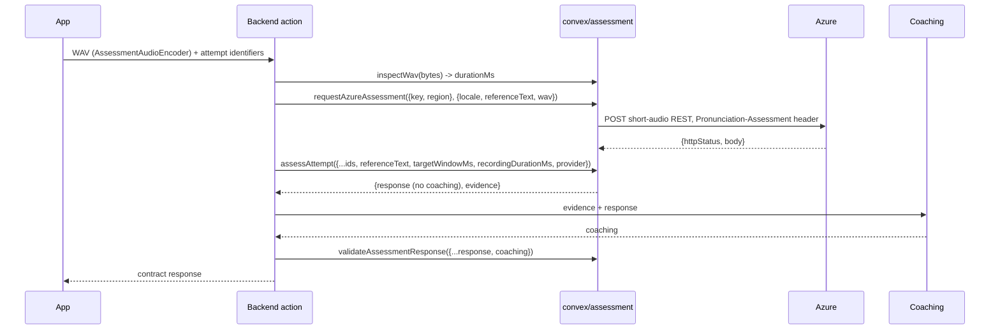

# Pronunciation assessment

Status: adapter and Swift models implemented against grading contract v1 (`docs/grading-contract.md`, rubric `language-v1`). The Azure call has not yet been exercised against the live service; see [Verification status](#verification-status).

The provider is Azure AI Speech pronunciation assessment, called server-side. The adapter is a pure TypeScript module in `convex/assessment/` that exports no Convex functions and adds no dependencies; the backend action owns secrets, storage, identity and job states, and calls into it.

## Flow



## Entry points (`convex/assessment/index.ts`)

```ts
assessAttempt(input: AssessAttemptInput): AssessmentOutcome        // pure; throws AssessmentError
validateAssessmentResponse(value: unknown, options?: { recordingDurationMs?: number }): AssessmentResponse
inspectWav(bytes: Uint8Array): { durationMs: number }              // 16 kHz mono 16-bit PCM, <= 30 s, else invalid_input
buildAzureRequest({ region? | baseUrl?, locale, referenceText }): { method, url, headers }   // no key
requestAzureAssessment(options, { locale, referenceText, wav }): Promise<{ httpStatus, body, durationMs }>
```

`requestAzureAssessment` is optional transport: it takes `fetch` and `sleep` as parameters, retries network failures, 408, 429 and 5xx up to `maxAttempts` (3) with exponential backoff, calls `warn` with a structured, secret-free record for each retry, and returns the last HTTP result so `assessAttempt` classifies it. The backend may instead make the HTTP call itself using `buildAzureRequest` and add `Ocp-Apim-Subscription-Key`.

### Input the backend must supply

| Field | Notes |
| --- | --- |
| `assessmentId`, `attemptId`, `lineId` | Non-empty strings the backend owns. A regrade gets a new `assessmentId`. |
| `referenceVersion` | Positive integer. |
| `locale` | `en-US` is implemented. Any other locale returns an `unscorable` / `unsupported_locale` outcome and `provider` is not inspected. |
| `recordedAt` | RFC 3339 capture time from validated attempt metadata. |
| `referenceText` | Resolved from stored project data, never from the client. Must tokenize to at least one word. |
| `targetWindowMs` | `{ startMs, endMs }` of the line in the source clip, integers, `0 <= startMs < endMs`. Used only for `timingFit`. |
| `recordingDurationMs` | Positive integer, at most 30,000. Take it from `inspectWav`. Word boundaries are checked against it. |
| `provider` | `{ httpStatus, body }` from Azure; `body` is the parsed JSON (or `undefined`). |

### Output

`AssessmentOutcome = { response, evidence }`. `response` is the contract response without `coaching`, with `status` `scored` or `unscorable`. The backend adds `coaching` (Tutoring) and must run `validateAssessmentResponse` on the complete object before persisting or returning it.

`AssessmentOutcome` also carries `provenance` for storage next to the assessment: `{ evaluator, measurement, modelVersion: null, evaluatorConfigVersion }`. Azure does not disclose a model version in its REST response, so none is recorded.

### Measurement

Every response carries `measurement: "acoustic" | "transcript_only"`, and so do `evidence` and `provenance`. The Azure path always emits `acoustic`. A `transcript_only` result (recognized text only, including any transcription or language-model output) must have null `pronunciation`, null `fluency` and a null `pronunciationScore` on every word; `wordAccuracy` and `timingFit` may be present. `validateAssessmentResponse` rejects a missing or unknown `measurement` and applies the `transcript_only` rules to it, and consumers treat a missing or unknown value as `transcript_only`. A transcript is never pronunciation or fluency evidence.

### Errors

`assessAttempt` throws `AssessmentError` with a `kind`. Each one fails the job; none is converted into `unscorable` or a score. Keep the recording so the job can be retried.

| kind | Cause | Retry |
| --- | --- | --- |
| `invalid_input` | Malformed identifier, timestamp, duration, window, or audio file | no |
| `invalid_reference` | Reference text has no tokens | no |
| `provider_unavailable` | Network failure, 408, 429, 5xx, or Azure `RecognitionStatus: Error` | yes (`error.retryable`) |
| `provider_auth` | 401 or 403 | no |
| `provider_rejected` | Other 4xx (unsupported language, unreadable audio) | no |
| `invalid_provider_response` | A 200 body missing a required field, out-of-range score, or word boundaries outside the recording | no |

`error.details` holds safe context only (status codes, field paths); it never contains the key, audio or transcript text.

`validateAssessmentResponse` throws `AssessmentValidationError` with an `issues` array.

## Azure request

The adapter uses the REST API for short audio (audio up to 60 s, up to 30 s for pronunciation assessment): `POST <endpoint>?language=en-US&format=detailed` with `Content-Type: audio/wav; codecs=audio/pcm; samplerate=16000` and a `Pronunciation-Assessment` header holding base64 JSON:

```json
{ "ReferenceText": "...", "GradingSystem": "HundredMark", "Granularity": "Word", "Dimension": "Comprehensive", "EnableMiscue": "True" }
```

Prosody is not requested: the contract excludes it from the initial response. The default host is `https://<region>.stt.speech.microsoft.com/speech/recognition/conversation/cognitiveservices/v1`; pass `baseUrl` to use the resource-name endpoint the current documentation shows (`https://<resource>.cognitiveservices.azure.com/stt/speech/recognition/conversation/cognitiveservices/v1`). Sources, read 2026-11-15:

- https://learn.microsoft.com/en-us/azure/ai-services/speech-service/rest-speech-to-text-short
- https://learn.microsoft.com/en-us/azure/ai-services/speech-service/how-to-pronunciation-assessment

## Metric mapping

| Contract field | Source |
| --- | --- |
| `pronunciation` | `AccuracyScore` of `NBest[0]`: the engine's phoneme-level pronunciation accuracy. `PronScore` is not used because it already blends fluency and completeness, which would count them twice in `languageOverall`. |
| `fluency` | `FluencyScore` of `NBest[0]`. |
| `wordAccuracy` | Computed from our alignment of normalized reference tokens against the tokens of the spoken words (`Words` entries whose `ErrorType` is not `Omission`): `100 x max(0, 1 - (S+D+I)/N)`. The engine's `CompletenessScore` is passed to Tutoring as evidence and is not a contract score. |
| `timingFit` | `round(100 x max(0, 1 - abs(d - t) / t))`, `d` = first spoken word start to last spoken word end, `t` = target window length. |
| `languageOverall` | `round(0.45 x pronunciation + 0.35 x wordAccuracy + 0.20 x fluency)` from unrounded components, halves up. |
| word `pronunciationScore` | The word's `AccuracyScore`, only for `matched` words. Substituted and inserted words get `null` with `unaligned_word`: the engine scores a word against its reference phonemes, and ours is a different word. Omissions get `null` with `omitted_word`. |
| word `startMs`/`endMs` | `Offset` and `Duration` (100-nanosecond units): start rounded down, end rounded up to whole ms, then clipped to the recording if within 50 ms (`BOUNDARY_TOLERANCE_MS`); a larger overshoot is `invalid_provider_response`. |

Displayed scores are rounded half up to integers; `evidence.rawScores` keeps the unrounded values.

`unavailableMetrics` is empty for every `scored` en-US response, because all five metrics are measured. The validator still enforces the null-score rules for responses from other sources.

### Unscorable classification

Only from observed evidence: `InitialSilenceTimeout` is `no_speech`; `BabbleTimeout` is `excessive_noise`; `NoMatch`, or `Success` with no spoken words, is `insufficient_speech`; a locale without an implemented tokenizer is `unsupported_locale`. No signal-to-noise threshold is applied because the documentation states none.

### Normalization (`language-v1`, en-US)

NFKC; curly apostrophes folded to `'`; em and en dashes act as separators; punctuation dropped, apostrophes and hyphens kept inside words; case-insensitive compare; digit runs (up to 12 digits) spelled out as cardinals so "25" matches "twenty five". Years, decimals and ordinals are not expanded and compare literally, so a reference containing "1999" will register a script mismatch against "nineteen ninety nine". Any change to these rules is a rubric revision.

## Evidence for Tutoring (`outcome.evidence`)

`provider` (name, locale, `recognitionStatus`, `snr`, `completenessScore`), `normalizationVersion`, `rawScores`, `referenceTokenCount`, `counts` (matched, substituted, omitted, inserted), `words` (`mispronounced` reference indices the engine flagged `ErrorType: Mispronunciation`, which Microsoft documents as word accuracy below 60; `substituted` and `omitted` reference indices; `inserted` count), `timing` (`spokenStartMs`, `spokenEndMs`, `spokenDurationMs`, `targetDurationMs`, `deltaMs`, positive when the learner ran long), and `unscorableReason`. Per-word detail is in `response.wordResults`. Coaching must cite only these measurements.

## Swift (`Dubbing/Assessment/`)

- `AssessmentContract.swift`: `Codable` models. `AssessmentResponse.measurement` decodes a missing or unknown value as `.transcriptOnly`, and the validator then rejects acoustic scores. Required-but-nullable keys use explicit `decode`, so a missing key is a decode failure, not a silent `nil`.
- `AssessmentValidation.swift`: `AssessmentContract.decode(_:recordingDurationMs:)` and `AssessmentResponse.validate(recordingDurationMs:)`, mirroring the TypeScript validator. It does not re-tokenize the reference text, so the backend alone checks that the alignment covers every reference token.
- `AssessmentState.swift`: `AssessmentState` is `.unavailable(reason)` (`.notConfigured`, or `.syntheticInput` for a take recorded through the QA audio fixture, which is never submitted for assessment), `.queued`, `.processing`, `.scored(response)`, `.unscorable(response)` or `.failed(AssessmentFailure)`. `AssessmentState.terminal(from:)` turns backend JSON into a terminal state; a malformed response becomes `.failed(.invalidResponse)`, never a score. `AssessmentFailure.Kind` mirrors the backend error kinds plus `transport` and `invalidResponse`.
- `AssessmentService.swift`: `PronunciationAssessing.assess(_:) -> AsyncStream<AssessmentState>` is what the backend transport conforms to. It sends identifiers and the WAV only; the backend resolves the reference text and window. `UnavailableAssessmentService` yields `.unavailable(.notConfigured)` and finishes; use it whenever no backend is configured. Nothing in the models accepts an on-device transcript as a measurement.
- `AssessmentAudioEncoder.swift`: `encode(from:to:)` converts a take to 16 kHz mono 16-bit PCM WAV at a different URL, leaving the original untouched. Takes over 30 s throw `tooLong` instead of being truncated.

## Verification status

See the report for the commit and results. Not covered by tests: the live Azure call (response shape, tick offsets relative to the audio start, hyphen and number handling in `Words`), the regional host form, and microphone capture on hardware.
