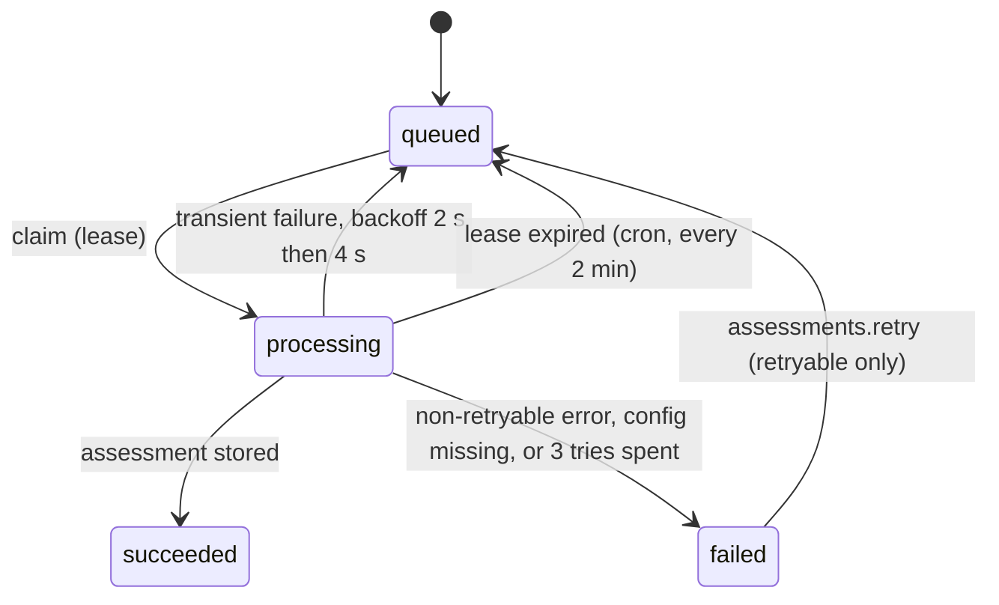

# Convex backend

The Convex backend stores scenes, learners' projects, recordings, accepted takes, and assessments, and
serves the coach HTTP routes. It follows the Convex backend contract v1 and the grading contract in
[grading-contract.md](grading-contract.md). Nothing here is deployed by the code in this repository;
the steps below are what the owner does once.

## Setup the owner must do

1. **Create a Convex project** and a development deployment (`npx convex dev` once logged in, or the
   dashboard). Production needs its own deployment and a deploy key for CI; neither is created by code.
2. **Turn on sign-in.** The app signs in with a username and password (`convex/passwordAuth.ts`). The
   backend signs its own session tokens and serves the public key at `/.well-known/jwks.json`, which
   `convex/auth.config.ts` points Convex at. Set the signing key, then create the shared demo logins
   (`demo`/`demo` and `demo1`/`demo1`):

   ```sh
   npx convex env set PASSWORD_AUTH_PRIVATE_KEY "$(node scripts/generate-password-auth-key.mjs)"
   npx convex run passwordAuth:seedDemoAccounts
   ```

   The backend accepts any identity Convex validates, so the Clerk provider (`CLERK_JWT_ISSUER_DOMAIN`)
   still works for other clients; changing providers means changing only `convex/auth.config.ts`.
3. **Set provider keys** on the deployment only for the features you turn on (table below).
4. **Seed the catalog** from a scene manifest (see Scene catalog). Pushing code never seeds data or
   runs migrations.

### Environment variables

Nothing is required to boot. A deployment with none set pushes cleanly; every signed-in function and
spending route then rejects, because no auth provider exists to produce an identity.

| Variable | Needed for | Secret |
| --- | --- | --- |
| `PASSWORD_AUTH_PRIVATE_KEY` | Username and password sign-in: signs session tokens and backs the public key route. Unset: sign-in fails and `/.well-known/jwks.json` answers 503. Replacing it signs everyone out. | yes |
| `CLERK_JWT_ISSUER_DOMAIN` | Signing in with Clerk. Unset means no Clerk provider. | no |
| `OPENAI_API_KEY` | The only LLM key. Used by runtime LLM workloads through `convex/lib/openai.ts`. Unset: routes that need it answer 503. | yes |
| `ANTHROPIC_API_KEY` | Read only by the not-yet-migrated coach reply until Tutoring's change lands, then retired. | yes |
| `LIVEAVATAR_API_KEY`, `LIVEAVATAR_AVATAR_ID_*`, `LIVEAVATAR_VOICE_ID_*`, `LIVEAVATAR_SANDBOX` | The talking coach (`POST /coach/session-token`). | key: yes |
| `AZURE_SPEECH_KEY` | Azure pronunciation assessment, the assessment engine. Unset (or without a region or endpoint): jobs fail with `engine_not_configured`. | yes |
| `AZURE_SPEECH_REGION` or `AZURE_SPEECH_ENDPOINT` | Where the Speech resource lives. The region (for example `eastus`) builds the regional host; the endpoint is the full recognition URL without a query string, for a resource with a custom domain, and wins when both are set. | no |
| `WHOP_WEBHOOK_SECRET` | The landing page's founding-plan payments (`POST /whop/webhook`). Unset: the route answers 503. Set it exactly as Whop shows it (`ws_…`). | yes |
| `DEV_ONLY_TEST_JWT_ISSUER`, `DEV_ONLY_TEST_JWT_AUDIENCE`, `DEV_ONLY_TEST_JWT_JWKS` | **Local development only.** Enables a test sign-in whose private key sits on a developer machine. **Never set these on a shared, preview, or production deployment.** All three must be set for the provider to exist. | no (but dangerous) |

How unset variables behave: Convex evaluates `auth.config.ts` on the deployment at push time and
throws when the file reads an unset variable, which fails the push (the CLI reports
`AuthConfigMissingEnvironmentVariable`). `auth.config.ts` reads each variable inside a try/catch, so an
unset variable only disables its provider. Probing with `"NAME" in process.env` does not work: it is
always false there. This was checked on a fresh local deployment with no variables set, and again
with only some set.

## Identity and ownership

- Every function derives the caller from `ctx.auth.getUserIdentity()`; no function takes a user id.
  `requireLearner(ctx)` in `convex/lib/auth.ts` returns `{ subject }` (the token identifier) and throws
  `UNAUTHENTICATED` otherwise. Tutoring uses the same helper.
- `users.ensure` creates the learner's row on first sign-in. Other functions throw `USER_NOT_FOUND`
  until it has run.
- Owned rows (`projects`, `attempts`, `acceptedTakes`, `assessmentJobs`, `assessments`) carry `ownerId`.
  Another user's row behaves exactly like a missing one: queries return `null`, mutations throw
  `NOT_FOUND`, and the media route answers 404.
- Errors thrown to clients are `ConvexError` with `data: { code, message }`. Codes: `UNAUTHENTICATED`,
  `USER_NOT_FOUND`, `NOT_FOUND`, `INVALID_ARGUMENT`, `INVALID_UPLOAD`, `CONFLICT`, `INVALID_STATE`,
  `INCOMPLETE_TAKES` (also carries `missingLineKeys`).

## Functions for the app

| Function | Purpose |
| --- | --- |
| `users.ensure()` | Register the signed-in learner. Returns `{ userId, created }`. |
| `users.setTimeZone({ timeZone })` | IANA zone, used as the fallback for each attempt's local day. |
| `scenes.list()` | Published scenes with their characters. |
| `scenes.get({ sceneId })` | A published scene with provenance, the newest revision of every line, and `videoUrl` for its stored video (null when none is attached). |
| `projects.start({ sceneId, characterId })` | Start dubbing one character; repeating it while active returns the same project. |
| `projects.get({ projectId })` | Project state with its accepted takes. |
| `attempts.generateUploadUrl()` | A one-time URL to POST the recording to. |
| `attempts.create({ projectId, lineId, clientAttemptId, storageId, durationMs, capturedAt, timeZone? })` | Claim an upload as an attempt and queue its assessment. Idempotent on `clientAttemptId`. Returns `{ attemptId, jobId }`. |
| `attempts.listForLine({ projectId, lineId })` | Takes of one line, newest first, with job state and the latest result summary. |
| `assessments.forAttempt({ attemptId })` | The latest job and the latest assessment of an attempt. |
| `assessments.retry({ jobId })` | Re-queue a failed, retryable job. |
| `takes.accept({ attemptId })` | Keep a take for its line; moves only the pointer. |
| `projects.complete({ projectId })` | Finish the dub once every line of the character has an accepted take. |
| `history.list({ status?, limit? })` | My Dubs: the learner's projects, newest activity first. |

Internal functions (not callable by clients): `scenes.seed`, `scenes.generateVideoUploadUrl`, `scenes.attachVideo`, `assessments.reassess`, and the job
internals (`run`, `claim`, `saveOutcome`, `complete`, `recordFailure`, `reclaimStale`, `media.attemptAudio`).

### HTTP routes

| Route | Auth | Notes |
| --- | --- | --- |
| `GET /health` | none | `{ ok: true, service: "dubby-backend", schemaVersion: 1 }`. Constants only. |
| `GET /coach/characters` | none | Unchanged. |
| `POST /waitlist` | none | Landing-page signup `{ email, plan?: "free" \| "founding", language?, source?, website? }`. CORS open to any origin. One row per lowercased email in `waitlist`; `founding` upgrades and never downgrades. A filled `website` honeypot gets `200` and stores nothing. `400` on bad input. |
| `POST /whop/webhook` | Whop signature | Whop `payment.succeeded`. Verifies the Standard Webhooks signature (`webhook-id`, `webhook-timestamp`, `webhook-signature`, HMAC-SHA256 with `WHOP_WEBHOOK_SECRET`, 5-minute window), then sets `paidAt` and `whopPaymentId` on the waitlist row for `data.metadata.email` (falling back to `customer_email`), adding the row if needed. `401` bad signature, `503` secret unset, `200` for other events. |
| `POST /coach/session-token` | Bearer | Unchanged body and response. 401 before any provider call; 400, 404, 503 as before. |
| `POST /coach/reply` | Bearer | Same. Still served by the baseline coach code (see Known gaps). |
| `GET /media/attempts/{attemptId}/audio` | Bearer | Streams the original recording to its owner, with byte ranges. 404 for anyone else. Recordings never get a raw storage URL. |

Every error body is `{ "error": string }`.

## Recordings

The app uploads WAV audio (`audio/wav`, 16 kHz mono 16-bit PCM), at most 30 s and 10 MB, and keeps
its original take locally. `attempts.create` checks the stored upload's content type and size, that the
project and line belong to the caller, a plausible `capturedAt` (at most 5 minutes ahead and 30 days
behind the server clock), and that no other attempt already claimed the storage id. The encoding
itself is checked by the engine before any provider call, which fails the job with `invalid_input` (not retryable) on a wrong format or a length over 30 s.
An attempt records the learner's time zone at capture time, from `timeZone` or the profile fallback.

## Assessment jobs

`attempts.create` inserts an attempt and an `initial` job and schedules it.



- **Stages.** `measure` calls the engine; `coach` calls the coaching provider. The validated engine
  outcome is stored on the job, so a retry of a coaching failure never calls the engine again.
- **Failure codes.** Every failure is explicit: `{ code, message, retryable }`. `engine_not_configured`
  and `coach_not_configured` are retryable and are not retried automatically. Engine error kinds
  `invalid_input`, `invalid_reference`, `provider_auth`, `provider_rejected`, and
  `invalid_provider_response` are not retryable; `provider_unavailable` is retried up to 3 tries and is then
  a retryable failure. `invalid_engine_output` and `invalid_coaching_output` mean a result broke the
  contract and are not retryable. `lease_expired` and `audio_missing` complete the set.
- **Unscorable audio** is a successful assessment with `status: "unscorable"`, not a failure.
- **Idempotency.** A repeated `attempts.create` returns the same attempt and job. `assessments.retry`
  re-queues the same job and never creates an attempt or a second assessment for it. A regrade
  (`assessments.reassess`, internal) makes a new `reassessment` job and a new assessment id for the same
  attempt. A learner's retry of a line is a new recording and therefore a new attempt.
- **Validation.** Before storing an engine outcome the backend checks that it describes this attempt,
  that every null score has exactly one unavailable-metric entry, that `languageOverall` never hides a
  missing component, that the alignment covers each reference word once in order, that word
  boundaries fit the recording, and that a `transcript_only` measurement carries no pronunciation
  value. The engine owns the totals; the backend does not recompute them. Coaching explains
  measurements and never supplies scores; word indices it cites must exist.
- **Logs.** Each outcome or failed try writes one JSON line (`operation`, ids, `status`, `errorCode`).
  Tokens, keys, audio, and transcripts are never logged.

### Plugging in the engine and coaching

Both are registered in `convex/integrations/providers.ts`. The engine seam in
`convex/integrations/contracts.ts` takes the assessment adapter's `AssessAttemptInput` plus the audio and
returns its `AssessmentOutcome` (response, evidence, and the evaluator provenance the job stores), with the
adapter's error kinds (`AssessmentError`). The backend passes its job id as `assessmentId` for
correlation; the stored assessment gets its own database id. Test doubles live only in test files.

The engine is Azure pronunciation assessment (`convex/integrations/azureEngine.ts`). It is registered
when `AZURE_SPEECH_KEY` and a region or endpoint are set; otherwise `getAssessmentEngine` returns `null`.
For each job it checks the WAV (16 kHz mono 16-bit PCM, at most 30 s), calls Azure with up to 3 tries
for network failures, 408, 429, and 5xx, and hands the response to the adapter. The duration it assesses
against is the WAV's own, not the client-reported length; the backend still rejects word boundaries
that run more than 250 ms past the reported length. A retry writes one log line with the job id,
attempt number, and status code, never the key, audio, or transcript. A 401 or 403 is `provider_auth`
and is not retried. No coaching provider is registered yet, so a scored job stores its outcome and ends
as `coach_not_configured`; once one is registered, `assessments.retry` finishes the job without calling
Azure again.

## Scene catalog

`scenes.seed` loads a scene from the fields of a Scene Manifest v1 plus `published`: `sceneId` becomes the
scene slug, `characters[].id` and `displayName` the characters, and `lines[].id` the stable `lineKey`.
Run it from an authorized machine:

```sh
npx convex run scenes:seed '<manifest json with "published": true>'
```

It validates finite times with `0 <= start < end <= durationSeconds`, resolvable character ids, sorted
lines, and no overlap among one character's lines. Re-running it with the same manifest changes
nothing. A changed line must carry a higher `referenceVersion`, which inserts a new row; attempts keep
the exact row they were recorded against. File entries and word timings are ignored.

The scene's video lives in Convex file storage. Seed the scene first, then upload and attach the file;
`_storage` records its SHA-256, size, and content type. Attaching a new video deletes the old one, and
re-seeding keeps the attached video.

```sh
URL=$(npx convex run scenes:generateVideoUploadUrl | tr -d '"')
curl -X POST -H "Content-Type: video/mp4" --data-binary @clip.mp4 "$URL"   # returns {"storageId": ...}
npx convex run scenes:attachVideo '{"slug":"<scene slug>","videoId":"<storageId>"}'
```

## Checks

```sh
npm ci
CONVEX_AGENT_MODE=anonymous npm run codegen   # regenerate convex/_generated against a local backend
npm run typecheck
npm test                                       # convex-test with two identities
```

Local end-to-end run over real HTTP, with no cloud account and no provider call:

```sh
CONVEX_AGENT_MODE=anonymous npx convex dev --once    # creates the local deployment under .convex/
node scripts/dev-auth.mjs configure                  # sets the DEV_ONLY_TEST_JWT_* variables locally
CONVEX_AGENT_MODE=anonymous npx convex dev           # leave running in another terminal
npm run smoke:local
```

## Known gaps

- Tutoring owns migrating the coach reply to the OpenAI Responses API, removing the Anthropic
  dependency, and moving the coach routes behind its own router. Until then `/coach/reply` still uses
  the baseline Anthropic code and needs `ANTHROPIC_API_KEY`.
- Calling Tutoring's ingestion after an assessment is stored is not wired; `convex/lib/ingest.ts`
  builds the payload and is tested. Deletion hooks are not wired either.
- No coaching provider is registered, so jobs end in `coach_not_configured` after the engine has scored them. The Azure engine has only been exercised against synthetic fixtures and a fake `fetch`, never a live Speech resource.
- Export upload (`projects.exportStorageId`), progress analytics, and account deletion are not built.
- A Convex storage id is unguessable but not bound to the user who uploaded it until `attempts.create`
  claims it.
